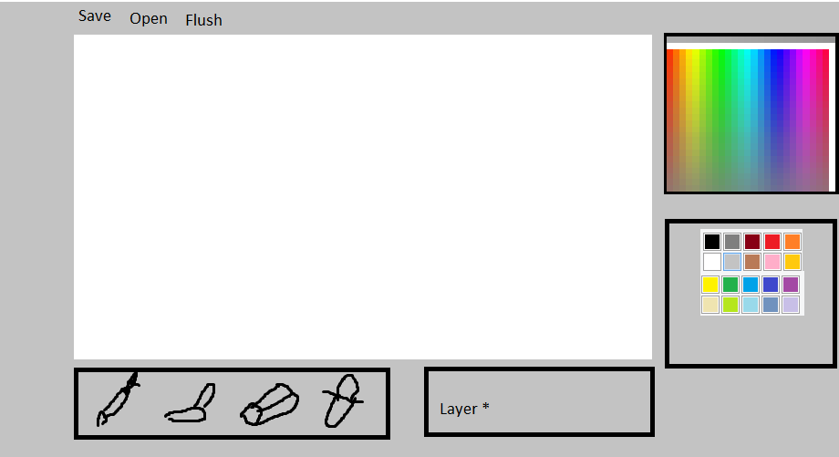
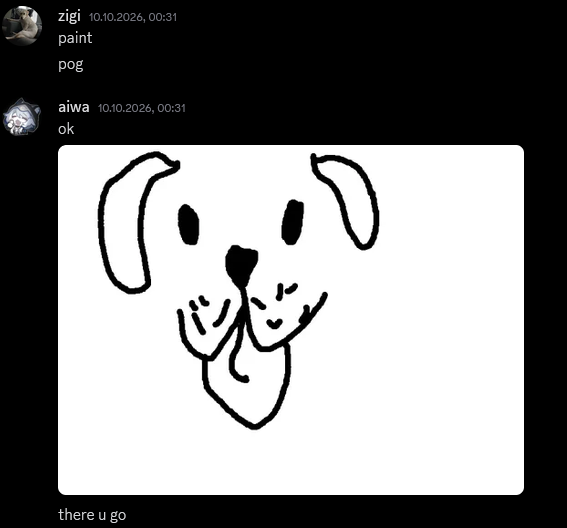
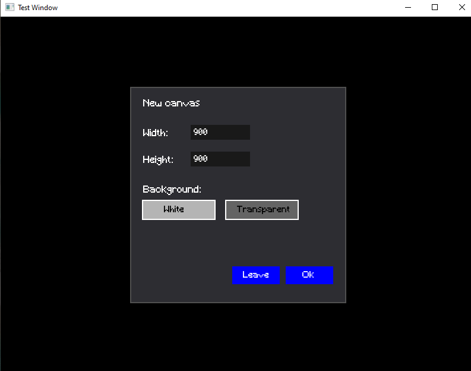
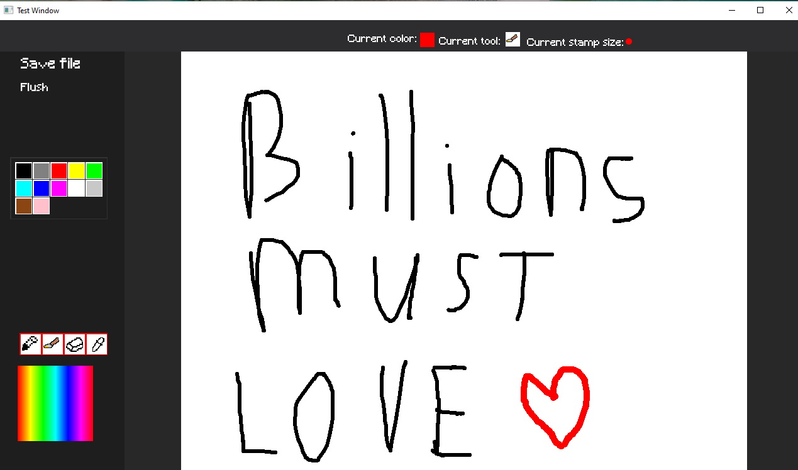

# 2D Painter

2D Painter is quite self-explanatory, the main idea behind this was to try and copy the libresprite where I was drawing the player textures for Fetch The Game

# What does it have:

* - Customizable size of future canvas with an addition of selecting it's background(either full white or transparent)
  - A specter of colors to pick for drawing
  - Basic set of tools(pencil, brush, colorpicker and eraser)

# Tech Stack used:

Language: C++

Framework: SFML 3.0

BuildSys: CMake

# How to run the build:

1) Clone the repo

   git clone https://github.com/www-cry/2DPainter.git
   cd 2DPainter

2) Create & open build directory

   mkdir build
   cd build

3) Configure project with CMake

   cmake ..

4) Build the .exe

   cmake --build . --config Release

# Known issues:

* - Resizeable window was sacrificed for the sake of canvas resizing the top and side bars
  - Currently the final thing can save only one image(Maybe I'll fix it by letting the newfilemenu select the name of the painting)
  - The stamp change is quite poor by size
  - eraser can really only erase while selecting the white bg(Tried to fix it but it didn't work so it was postponed)

# Some screenshots and comments from my friends regarding it:

   - How I thought that the final UI would end:
   

   - Asking for a dog image:
   

   - Creating new canvas UI:
   

   - Example of drawing:
   

   - Saved drawing:
   

